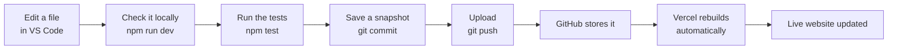

# This project, explained from scratch

This guide assumes you know nothing about software development. It explains what Atlas of Art is, how its pieces fit together and what every folder is for, using everyday comparisons. You don't need to understand everything on a first read; the [learning path](README.md) teaches each idea properly in 10-minute lessons.

---

## 1. What is a website, really?

When you type an address such as `virtual-art-gallery.vercel.app` into a browser (Chrome, Edge, Safari):

1. Your browser sends a **request** over the internet to a computer somewhere, called a **server**.
2. The server sends back a **response**: files that describe the page.
3. Your browser reads those files and draws the page on your screen.

> **Analogy: a restaurant.** You (the browser) give an order (the request) to the kitchen (the server). The kitchen sends back a dish (the response). You never see the kitchen, only the dish.

The files a browser understands are written in three languages:

| Language | Job | Restaurant analogy |
|---|---|---|
| **HTML** | The content and structure: headings, paragraphs, images, buttons | The food on the plate |
| **CSS** | The look: colours, fonts, spacing, layout | The plating and presentation |
| **JavaScript** | The behaviour: what happens when you click, type or scroll | The waiter reacting to your requests |

## 2. What does *this* website do?

Atlas of Art is a **virtual art gallery**. It doesn't store any paintings itself. Instead, every time you search, it asks real museums for matching artworks and shows you the results:

- the Art Institute of Chicago
- The Metropolitan Museum of Art (the Met)
- the Cleveland Museum of Art
- the Victoria and Albert Museum (V&A) in London
- Wikidata, a free global encyclopedia of facts

You can filter by **region** (for example, East Asia), **era** (for example, the 1790s) and **style** (for example, ukiyo-e).

> **Analogy: a travel agent.** You tell the agent what you want ("Japanese prints from the 1700s"). The agent phones five museums, collects their answers, removes duplicates and hands you one tidy brochure. Atlas of Art is that travel agent.

## 3. How do programs talk to the museums? APIs

Museums publish an **API** (Application Programming Interface). An API is a door built for *programs* rather than people: you send a precisely worded request and get back data instead of a pretty web page.

For example, you can paste this into your browser's address bar:

```
https://api.artic.edu/api/v1/artworks/search?q=monet&limit=2&fields=title,artist_display
```

You'll see text that looks like this:

```json
{ "data": [ { "title": "Water Lilies", "artist_display": "Claude Monet (French, 1840–1926)" } ] }
```

This format is called **JSON**. It is just labelled data, a bit like a filled-in form. Every museum's API answers in a slightly different format, so a big part of this project is *translating* five different formats into one.

## 4. The two halves: front end and back end

| Half | Runs on | In this project | Analogy |
|---|---|---|---|
| **Front end** (the "client") | Your browser | The pages, filters, buttons and image grid you see | The restaurant's dining room |
| **Back end** (the "server") | A computer at Vercel | Code that phones the museums, translates their answers and sends one combined list to the browser | The kitchen |

Why not let the browser phone the museums directly? There are three reasons:
- **Secrets.** Some museums need a private key (like a password). Keys must never be sent to visitors' browsers.
- **Translation.** It's simpler to translate once on the server.
- **Speed.** The server remembers recent answers (this is called *caching*), so the next visitor gets them instantly.

## 5. The tools this project is built with

You'll meet each of these in the learning path. For now, it's enough to know what each one is for.

| Tool | What it is | Why we use it |
|---|---|---|
| **TypeScript** | JavaScript with labels saying what kind of data each thing holds | It catches mistakes before the site runs |
| **React** | A way to build pages out of reusable pieces called *components* | One artwork card is written once and reused hundreds of times |
| **Next.js** | A framework built on React that handles pages, the back end and building the site | Front end and back end live in one project |
| **Mantine** | A library of ready-made components: buttons, sliders, chips, drawers | We don't hand-draw every button |
| **Node.js** and **npm** | Node runs JavaScript on your computer; npm downloads the libraries the project needs | Needed to run and build the project |
| **Git** | Keeps a history of every change to the code | You can undo mistakes and see who changed what |
| **GitHub** | A website that stores Git projects online | The code is backed up and shared there |
| **Vercel** | A hosting company that turns the code on GitHub into a live website | Free for personal projects, and it updates automatically on every change |
| **Vitest** | Runs automatic checks ("tests") on the code | Confirms nothing broke after a change |

## 6. Following one click from start to finish

Here's what happens when you choose **East Asia**, then **18th century**, then **Ukiyo-e** on the Explore page:

1. **The address bar changes** to `/explore?regions=east-asia&from=1700&to=1799&styles=ukiyo-e`. The filters live in the address, which is why you can copy the link and share it.
   *(Code: `src/hooks/useExploreState.ts`)*
2. **The page asks our own back end** for results: `GET /api/artworks?regions=east-asia&from=1700&to=1799&styles=ukiyo-e`.
   *(Code: `src/hooks/useArtworkSearch.ts`)*
3. **The back end reads the request** and turns it into a tidy description of the search.
   *(Code: `src/app/api/artworks/route.ts` and `src/lib/query.ts`)*
4. **It contacts all the museums at the same time.** Each museum has its own "adapter", a small translator that knows how to ask that museum in its own language.
   *(Code: `src/lib/sources/aic.ts`, `met.ts`, `cma.ts`, `vam.ts`, `wikidata.ts`)*
5. **Each adapter translates the museum's answer** into our single standard format, called an `Artwork`.
   *(Code: the `Artwork` type is in `src/types/artwork.ts`)*
6. **The answers are combined.** The aggregator mixes the results, removes duplicates and, after 3.5 seconds, sends back whatever has arrived. Slow museums catch up when you scroll.
   *(Code: `src/lib/aggregate.ts`)*
7. **The browser draws the cards** in a grid. As you scroll, it asks for the next page.
   *(Code: `src/components/explore/ExploreClient.tsx` and `src/components/gallery/ArtworkCard.tsx`)*

## 7. A tour of the folders

```
virtual-art-gallery/
├─ src/                    ← all the app's code
│  ├─ app/                 ← one folder per web page (Next.js reads this to make the pages)
│  │  ├─ page.tsx          ← the home page
│  │  ├─ explore/          ← the Explore page
│  │  ├─ artwork/          ← a single artwork's page
│  │  ├─ favourites/       ← the Favourites page
│  │  ├─ help/             ← the Guide page
│  │  ├─ api/              ← the back-end "doors" the front end calls
│  │  ├─ layout.tsx        ← the frame around every page (header, footer, fonts)
│  │  └─ globals.css       ← site-wide styles (colours, the masonry grid)
│  ├─ components/          ← reusable building blocks (filters, cards, map…)
│  ├─ hooks/               ← reusable React logic (reading filters from the URL, searching)
│  ├─ lib/                 ← plain logic with no visuals
│  │  └─ sources/          ← one translator ("adapter") per museum
│  ├─ taxonomy/            ← the art-history knowledge: regions, eras, styles
│  ├─ types/               ← the shape of an Artwork
│  └─ theme.ts             ← fonts and colours for Mantine
├─ tests/                  ← automatic checks (run with `npm test`)
├─ docs/                   ← all documentation, including this guide
├─ scripts/                ← helper scripts (recording sample museum answers)
├─ package.json            ← the project's ID card: name, commands, libraries it needs
├─ package-lock.json       ← the exact versions of every library (don't edit by hand)
├─ .env.example            ← a template listing the optional secret keys
├─ .gitignore              ← files Git should never save (secrets, downloaded libraries)
└─ README.md               ← the front page of the project on GitHub
```

You'll also see folders that are **not** saved in Git:

| Folder | What it is |
|---|---|
| `node_modules/` | Libraries downloaded by `npm install`. Huge, and re-creatable at any time. |
| `.next/` | The built website. Re-created by `npm run build` or `npm run dev`. |

## 8. What do the file endings mean?

| Ending | Meaning |
|---|---|
| `.ts` | TypeScript (logic, no visuals) |
| `.tsx` | TypeScript that also contains page markup (React components) |
| `.css` | Styles |
| `.json` | Data or settings |
| `.md` | Markdown: formatted text, like these docs |
| `.mjs` / `.cjs` | JavaScript files in two different module styles (mostly configuration) |

## 9. The life of a change

This is how a change goes from your computer to the live website:



## 10. Where to go next

Start the [learning path](README.md). Module 1 gets you from zero to running this website on your own computer in about 40 minutes. Keep the [glossary](glossary.md) open in another tab for any unfamiliar word.
