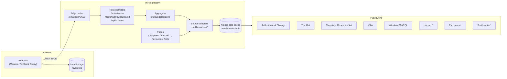

# Architecture

Atlas of Art is a single Next.js application deployed to Vercel's free (Hobby) plan. It has **no database** and **no user accounts**. Artwork data is fetched live from public museum APIs, normalised on the server and cached at Vercel's edge.

## System overview



\* Optional sources: these switch on only when their API key is set as an environment variable.

## Request flow: a search

```mermaid
sequenceDiagram
  participant U as Browser (Explore)
  participant R as /api/artworks
  participant A as aggregate.searchAll
  participant S as Adapters (parallel)
  participant M as Museum APIs

  U->>R: GET ?regions=east-asia&from=1700&to=1799&styles=ukiyo-e
  R->>A: parseQuery() → SearchQuery
  A->>S: search(query, cursor, 8) for each enabled source
  S->>M: translated requests (ES query, SPARQL, REST)
  M-->>S: raw JSON
  S-->>A: normalised Artwork[] + per-source cursor
  Note over A: after 3.5 s, respond with what has arrived;<br/>late sources keep their cursor for the next page
  A-->>R: interleave → dedupe → sort
  R-->>U: { items, cursor, sources[] } + Cache-Control
  U->>R: (scroll) GET …&cursor=…
```

## Layers

| Layer | Location | Responsibility |
|---|---|---|
| Taxonomy | `src/taxonomy/` | Static definitions of regions, eras (centuries, decades, periods) and styles, and how each maps to every API's vocabulary. Also the style compatibility logic. |
| Types | `src/types/artwork.ts` | The normalised `Artwork`, `SearchQuery` and response types shared by server and client. |
| URL schema | `src/lib/query.ts` | One parser/serialiser (`parseQuery`, `toSearchParams`) for the page URL and the API. Validated with Zod. |
| HTTP | `src/lib/http.ts` | `fetchJson` with timeout, one retry, a generic User-Agent and Next.js caching. Also year and HTML helpers. |
| Adapters | `src/lib/sources/*.ts` | One file per museum. Each translates a `SearchQuery` into that API's request and normalises the response. |
| Aggregator | `src/lib/aggregate.ts` | Runs adapters in parallel, enforces time budgets, interleaves, deduplicates, sorts and builds the combined cursor. |
| API routes | `src/app/api/**/route.ts` | Thin HTTP wrappers that set cache headers. |
| Pages | `src/app/**/page.tsx` | Home, Explore, Artwork detail (server-rendered, ISR), Favourites, Guide. |
| Components | `src/components/**` | Filters, gallery views, artwork detail, layout. |
| Client state | `src/hooks/*`, `src/lib/favourites.ts` | URL-backed filter state, infinite search query, localStorage favourites. |

## Key design decisions

- **Server-side aggregation.** The browser never calls the museums directly. This keeps API keys secret, avoids CORS differences between APIs, lets Vercel cache results, and means one normalised response format.
- **Adapters are pure translators.** Adding a museum means adding one file that implements `SourceAdapter` and registering it in `src/lib/sources/index.ts`. Nothing else changes.
- **Taxonomy as data.** Regions and styles carry each API's own vocabulary (Met `geoLocation` values, AIC style term IDs, Wikidata QIDs and so on), so geography and art-historical knowledge live in one reviewable place.
- **The URL is the state.** Every filter is in the query string, which gives shareable links, back-button undo and edge-cacheable API calls.
- **Graceful degradation.** Each source has its own time budget and status. A slow or failing museum never breaks the page; the UI shows which sources answered.

See [decisions.md](decisions.md) for the reasoning behind the technology choices.

## Directory map

```
src/
  app/
    api/artworks/route.ts             federated search
    api/artworks/[source]/[id]/route.ts  single artwork
    api/sources/route.ts              which sources are enabled
    artwork/[source]/[id]/page.tsx    detail page (server component, ISR)
    explore/page.tsx                  Explore (client)
    favourites/page.tsx               favourites (client, localStorage)
    help/page.tsx                     renders docs/user-guide at build time
    layout.tsx, providers.tsx, globals.css
  components/{artwork,explore,filters,gallery,help,home,layout}/
  hooks/{useExploreState,useArtworkSearch}.ts
  lib/{aggregate,http,query,journeys,favourites,sourceNames}.ts
  lib/sources/{aic,met,cma,vam,wikidata,harvard,europeana,smithsonian,types,index}.ts
  taxonomy/{regions,eras,styles,compat}.ts
  types/artwork.ts
  theme.ts
tests/            Vitest unit tests + recorded API fixtures
scripts/          record-fixtures.mjs
docs/             technical, user-guide, setup
```
